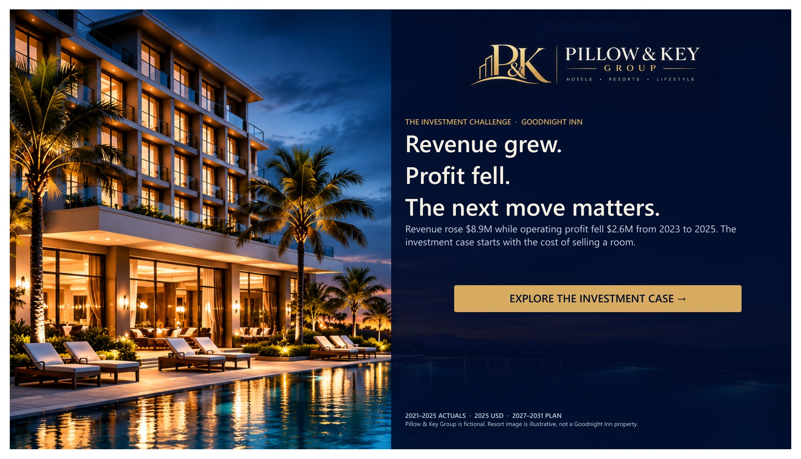
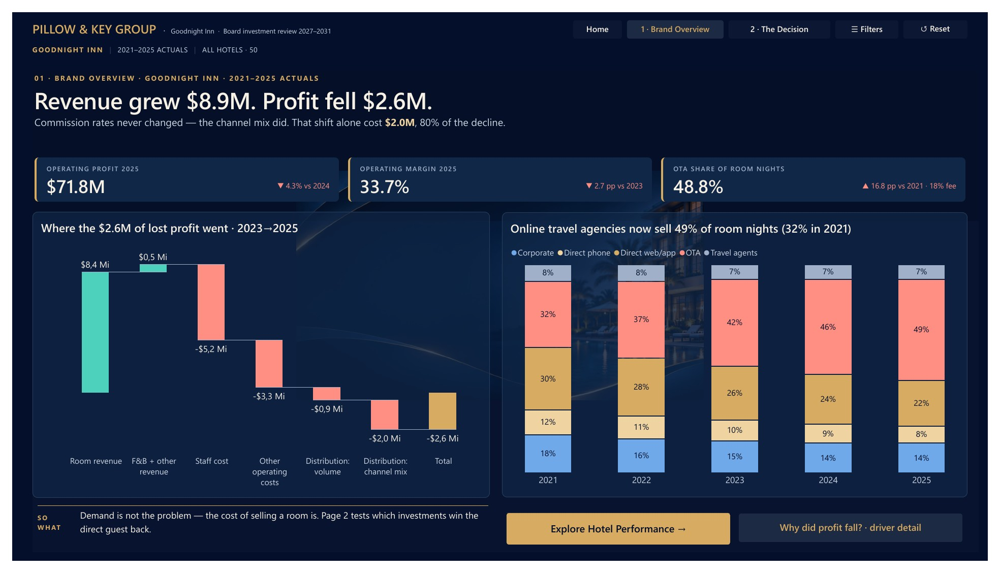
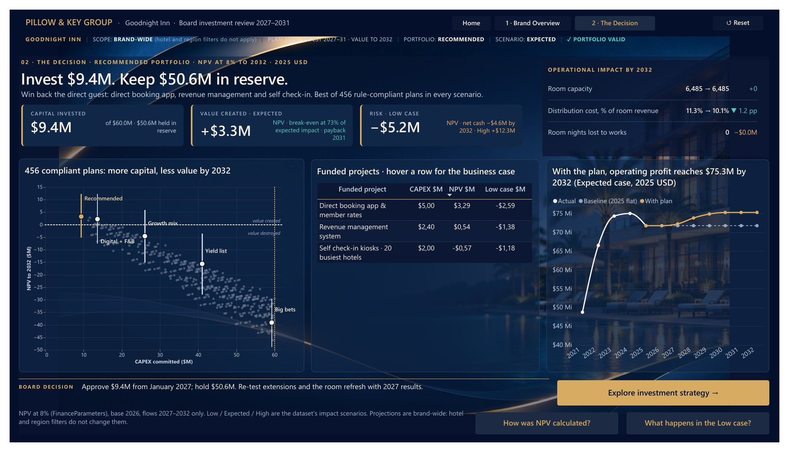

# Goodnight Inn | The Investment Challenge

**Power BI DataViz World Championships 2027 · Round 1**
*Revenue grew. Profit fell. The next move matters.*

This Power BI report examines **Goodnight Inn**, the budget and economy brand of the fictional Pillow & Key Group. It connects the brand's operating problem to an investment decision that can be inspected, challenged and compared with alternatives.

## The decision in brief

Goodnight Inn's revenue grew **$8.9M** from 2023 to 2025 while operating profit fell **$2.6M**. Online travel agencies' share of room nights rose from 32% to 49%. With unchanged commission rates, the channel mix shift added approximately **$2.05M** in distribution costs, about 80% of the profit decline. This is an accounting decomposition; the supplied data do not explain why guests changed channels.

The recommended portfolio combines **GI-01 (direct booking app), GI-10 (revenue management) and GI-02 (self check-in kiosks)**. It commits **$9.4M** of the $60M budget and holds **$50.6M** in reserve. Among **456 rule-compliant portfolios** from 1,024 combinations, it ranks first in the Low, Expected and High scenarios. At the dataset's 8% discount rate through 2032, its **Expected NPV is +$3.25M**. The **Low-case NPV is −$5.15M**; this downside is shown in the report.

## Explore the report

The report has **two visible pages**. Its Home is an overlay on the first page, opened through a bookmark.

| View | What it answers |
|---|---|
| **Brand Overview** | Where did profit go despite revenue growth? Explore the profit bridge, booking-channel mix and hotel-level performance. |
| **The Decision** | Which investments create value? Compare compliant portfolios, funded projects, operational impact, timing and scenario risk. |

Additional bookmark states and contextual tooltips reveal detail without adding visible report pages. The core views use native Power BI charts and tables alongside purpose-built explanatory panels.

### Brand Overview

### The Decision

## Files

| File or folder | Purpose |
|---|---|
| [`The Investment Challenge - Goodnight Inn.pbix`](The%20Investment%20Challenge%20-%20Goodnight%20Inn.pbix) | Ready-to-open Power BI Desktop report with imported data. |
| [`The Investment Challenge.pbip`](The%20Investment%20Challenge.pbip) | Editable Power BI Project entry point. |
| `The Investment Challenge.Report/` | PBIR report definition, bookmarks, visuals and embedded design resources. |
| `The Investment Challenge.SemanticModel/` | TMDL semantic model and DAX measures. |
| [`PillowKey_Dataset.xlsx`](PillowKey_Dataset.xlsx) | Original challenge dataset, included unchanged for reproducibility. |
| [`docs/FINANCIAL_AUDIT.md`](docs/FINANCIAL_AUDIT.md) | Independent portfolio and cash-flow audit, assumptions and scenario results. |
| [`docs/AUDIT_all_valid_portfolios.csv`](docs/AUDIT_all_valid_portfolios.csv) | Audit output for all 456 compliant portfolios. |
| `submission/` | Three current report images and draft submission text. |

Open the **PBIX** for the quickest review. Open the **PBIP** to inspect or edit the report and model. The model's `DataFile` parameter points to the [public challenge dataset](https://community.fabric.microsoft.com/blog/community_blog/power-bi-dataviz-world-champs-2027--round-1/5390883); change that parameter in Power Query if you prefer the local workbook before refreshing.

## Data, assumptions and credits

All business data come from the official fictional [Round 1 challenge](https://community.fabric.microsoft.com/blog/community_blog/power-bi-dataviz-world-champs-2027--round-1/5390883). The investment model uses the challenge's project data, budget and 8% discount rate. The [financial audit](docs/FINANCIAL_AUDIT.md) documents the calculation horizon, assumptions and the Low/Expected/High outcomes. Scenario probabilities were not provided, so the report does not assign them.

The resort image on the Home is **illustrative and does not depict a Goodnight Inn property**, as disclosed on the report itself. Pillow & Key Group is fictional. Challenge data and branding remain credited to their original source; no license to those materials is implied by this repository.
